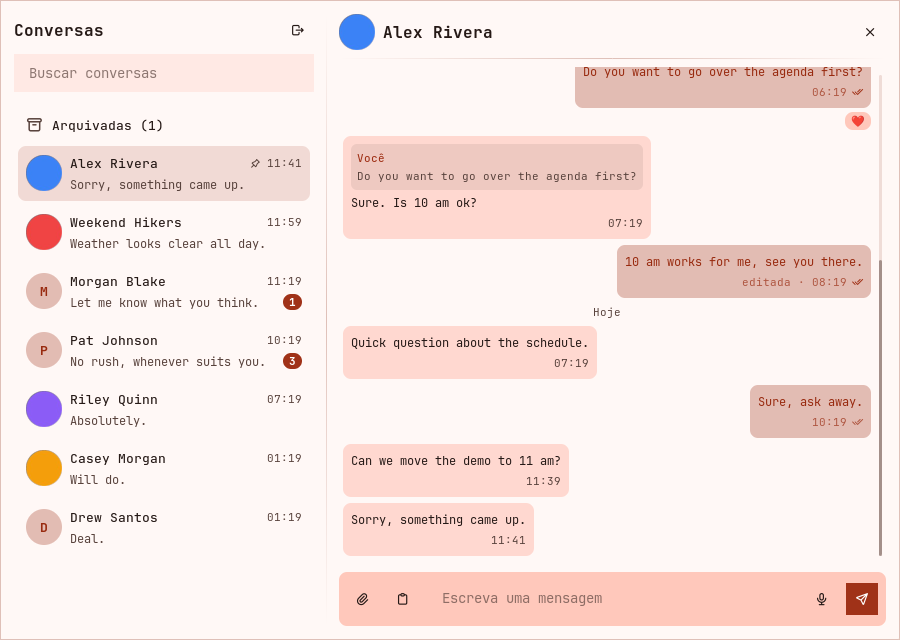

# Zap for Noctalia

A WhatsApp client that lives in the [Noctalia](https://github.com/noctalia-dev/noctalia) bar. The plugin draws the
whole interface: unread badge, chat list, conversations, media, QR login. A small Go helper, `noctalia-zapd`, talks to
WhatsApp through [whatsmeow](https://github.com/tulir/whatsmeow).



> Status: early version (0.1.x). It works day to day for its author, but expect rough edges.

## Before you use it

This is an unofficial client. WhatsApp's terms forbid third-party clients and WhatsApp can ban a number that uses
one. Try it with a spare number first.

The session, messages and media stay on your machine, in the plugin's data directory. Nothing is sent anywhere except
to WhatsApp's own servers.

## Install

1. Install the helper. Download `noctalia-zapd` from the
   [latest release](https://github.com/claudio-asj/noctalia-zap/releases), check it and put it on your `PATH`:

   ```sh
   tar xzf noctalia-zapd-*-linux-amd64.tar.gz
   sha256sum -c noctalia-zapd-*-linux-amd64.tar.gz.sha256
   install -m 755 noctalia-zapd ~/.local/bin/
   ```

   Or build it yourself (needs Go and gcc, since SQLite uses cgo):

   ```sh
   cd daemon && go build -trimpath -o ~/.local/bin/noctalia-zapd .
   ```

2. Install the plugin `claudio-asj/zap` from the Noctalia plugin store (once it is listed), or link
   `plugin/zap` into `~/.local/share/noctalia/plugins/zap` and enable it in Settings → Plugins.

3. Open the panel and scan the QR code with WhatsApp on your phone (Settings → Linked devices).

The plugin page, with every setting and optional dependency, is [plugin/zap/README.md](plugin/zap/README.md).

## Layout

```
daemon/       noctalia-zapd (Go + whatsmeow): session, messages, media, one JSON event per line
plugin/zap/   Noctalia plugin (Luau), id claudio-asj/zap
docs/         architecture, protocol, API notes and roadmap (in Portuguese)
```

## Trying it without an account

Turn on the advanced setting "Demo mode". The helper then runs with made-up chats in a separate folder and never
connects to WhatsApp.

## License

MIT.
